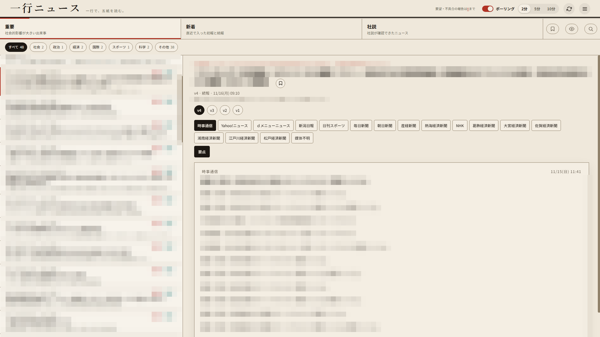
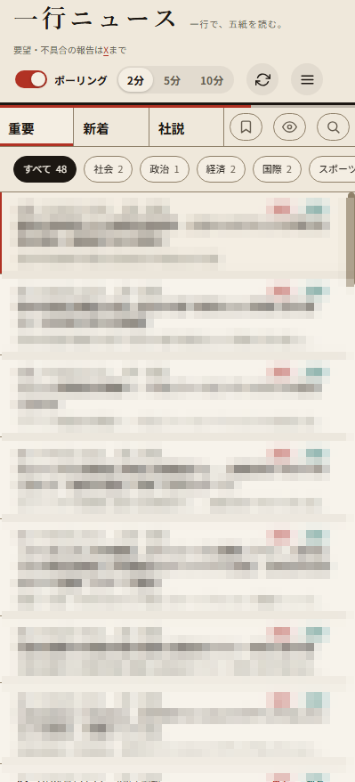
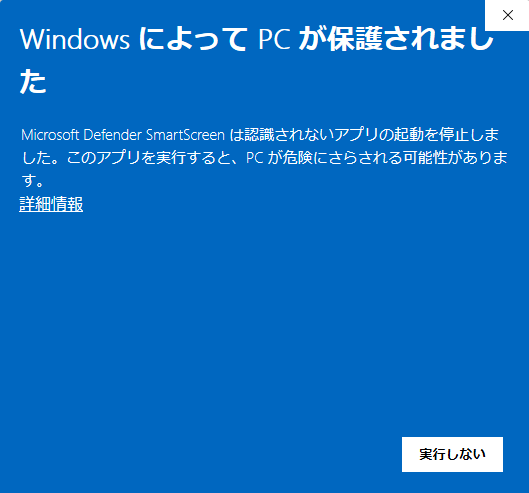

# 一行ニュース

一行で、五紙を読む。

同じ事件でも、朝日と読売では見出しが違う。社説まで読むと、各紙が何を問題だと思っているかが見えてくる。とはいえ五紙を毎日読む時間は無いし、ニュースアプリのまとめは「違い」の部分を均してしまう。

一行ニュースは、同じニュースを一行に集約し、五紙とNHK・共同・時事の報道を横に並べる個人用のリーダーです。続報は別のニュースにせず、同じニュースの版（v2、v3…）として積みます。社説が確認できた紙には社説も付けます。重要かどうかは「直近24時間で、新聞の1面・2面に載る水準か」で測ります。

取得はアプリ本体が起動している間だけです。本体を終了すれば収集も止まります。記事ページの本文は取りに行きません。RSSで届いた見出しと抜粋を並べ、続きは元記事へのリンクから読む形です。抜粋はRSSで届いた文を整形して出すだけで、AIで要約したり、文を選んだり書き換えたりはしていません。その割り切りも含めての仕様です。

**できること**
- 五紙と NHK、共同・時事の見出しを RSS で集め、同じニュースを一行にまとめる
- 続報は新しい行を作らず、版（v2、v3…）で重ねる。古い版も残る
- 各紙の報道（RSS 抜粋）と社説を同じ画面で比べる。社説が確認できないものは「確認できず」と出す
- 重要・新着・社説の3つの見方と、カテゴリの絞り込み
- キーワードを登録すると、その話題を更新のたびに集めてくる
- キーワード検索とブックマーク
- ポーリング（2分・5分・10分）で、開きっぱなしでも新着を追う。未読数はタブのタイトルに出る
- スポットライト表示では、開いているタブの一覧を1件ずつ大きく表示して順に切り替える。表示時間は10秒・20秒・30秒・60秒から選べ、更新が入ると先頭から流し直す
- テーマは紙・古紙・白黒・灯・墨。文字の大きさと一覧の密度も変えられる
- データは自分の PC の中だけに置く。取得は自分の PC で動く本体の中だけなので、常駐サーバーはいらない

## なぜ作ったか

見出しの強い記事ほど広く回る。回るうちに、その紙の切り取り方まで一緒に広がって、ものの見方が寄っていく。同じニュースを一行に集めて五紙の報道と社説を並べたのは、その対策としてだ。どこまでが事実で、どこからが各紙の味付けか、そこまでを興味の対象に。

ニュースは探しに行くものではなく、目に入るものであってほしい。サブディスプレイに開きっぱなしにして、ポーリングで最新を追わせる。重要なものも、そうじゃないものも視界の端からアクセスできる。

社説は各紙の立場が一番出る読み物なのに、たどり着くまでの手間が一番かかる。記事と同じ画面で、そのまま読めるようにした。

更新情報と連絡先は X の [@ichigyo_news](https://x.com/ichigyo_news) です。要望・不具合の報告は X までお願いします。



PC では一覧と詳細を並べる。



スマホ幅では一覧と詳細を別画面に分け、スワイプで行き来する。

スポットライト表示で、新着タブの一覧を流しているところ。音声はありません。

https://github.com/user-attachments/assets/d5ba0658-cb86-4e78-a18e-35c7ba4a93c7

## 仕組み

収集元は公開RSSのみです。NHK（カテゴリ別）、朝日・読売・毎日・日経・産経・時事・共同の各紙ドメイン検索を含むGoogleニュース、Yahoo!ニュース、朝日と時事の公式RSSを組み合わせています。新聞デジタル版の購読は前提にしておらず、有料本文は扱いません（元記事へのリンク提示のみ）。

届いた記事は、見出しの単語の一致を手がかりに同じニュースへまとめます（クラスタリング）。新しい事実を含む続報が来た時だけ版が上がり、同内容の他紙報道が増えただけでは版は上がらず、その版の報道に追加されます。

詳細を開くと、そのニュースに対する各紙の報道が、見出しとRSSの抜粋で並びます。画面で「RSS 抜粋」と表示しているのは、RSSで届いた抜粋文を、文の切れ目を保ったまま先頭から一定の長さ（140字程度）に整形したものです。文を選び直したり、要約し直したりはしていません。全文は各紙の「元記事を読む」リンクから。社説はニュース単位で自動確認し、見つかった紙の社説だけを表示します。見つからなかった紙は「確認できませんでした」と表示し、他の紙の社説で代用することはしません。

重要度は、直近24時間の活動（各紙が独自に報じているか、通信社配信の複製ではないか、版の積み上がり、社説で取り上げた紙があるか）だけで計算します。24時間より前の蓄積では膨らませず、窓の中に動きの無いニュースは重要タブに出ません。

## 画面の構成

タブは「重要」「新着」「社説」の3つです。重要は上記の物差しで並び、新着は版が作られた順、社説は社説が確認できたニュースだけを並べます。各タブともカテゴリ（社会／政治／経済／国際／スポーツ／文化・エンタメ／科学／その他）のチップで絞り込めます。

タブの並びとは別に、右端にブックマーク、キーワード、検索の入口があります。

- ブックマーク: 詳細から保存したニュースを、最新版だけブックマークした順に並べます。
- キーワード: 登録した語を含むニュースだけを見るビューです。キーワードは眺める条件であると同時に収集のクエリでもあり、更新のたびにキーワード検索のRSSも取りに行きます（登録は20件まで）。表記ゆれ（例: 漏洩／漏えい）は正規化して照合します。
- 検索: 自由な語でその場で検索します。照合の仕組みはキーワードと同じで、検索結果からそのままキーワード登録もできます。

詳細では版をチップで切り替えて読み比べられます。各紙の報道ごとに、RSSの抜粋と元記事へのリンクを表示します。

マストヘッドの「ポーリング」をONにすると、本体が起動している間、2分／5分／10分間隔で自動更新します。タブを閉じても収集は続き、本体を終了すると止まります。横のディスプレイに開きっぱなしにして、重要なニュースが目に入る使い方を想定しています。常駐の収集サーバーを別に立てる形にはしません。

## 配布版（Windows exe）

GitHub の Releases に Windows 向けの単一 exe（`ichigyo-news-win32-x64.exe`、約90MB）を置いています。Node.js のインストールは不要で、ダブルクリックするとサーバーが起動し、既定ブラウザで http://localhost:8787 が自動で開きます。止める時は、起動時に出るコンソール画面を閉じてください。

初回起動時は「Windows によって PC が保護されました」という画面（SmartScreen）が出ます。個人開発の OSS でコード署名をしていないため出るもので、ファイルから怪しい動作を検出したという意味ではありません。進み方は2クリックです。まず「詳細情報」を押すと「実行」ボタンが出るので、それを押してください。



初回起動時に出る画面。「詳細情報」を押すと「実行」ボタンが出る。

心配な場合は、ダウンロードしたファイルの SHA-256 を照合できます。各リリースのノートに exe の SHA-256 を載せているので、手元のファイルから計算した値と一致するか確認してください。

データ（SQLite）は `%APPDATA%\ichigyo-news\news.db` に作ります。保存先は環境変数 `ICHIGYO_DATA_DIR` で変更できます。ブラウザを自動で開かないようにするには `ICHIGYO_NO_BROWSER=1` を指定します。`PORT` など他の環境変数も Node.js 版と同じです。アンインストールは、exe とデータフォルダを削除するだけです。

## 起動方法

Node.js から起動する場合は Node.js 22 以上が必要です。サーバー側は Node 標準ライブラリのみで作っており、依存パッケージのインストールは要りません。UIのビルド済み成果物も `public/` に入っているので、通常の起動にビルドは不要です。

```
node server.mjs
```

ブラウザで http://localhost:8787 を開いてください。データは `data/news.db`（SQLite）に貯まります。

環境変数:

- `PORT`: 待ち受けポート（既定 8787）
- `HOST`: 待ち受けアドレス（既定 `127.0.0.1` で、同じ端末からだけ接続できます）。スマホなど同じネットワークの別端末から開く場合だけ `HOST=0.0.0.0` のように明示指定してください。その場合は `ACCESS_TOKEN` の設定が必須です。
- `ACCESS_TOKEN`: 設定すると画面・APIの全リクエストにトークン認証を要求します。初回は `http://…:8787/?token=<トークン>` で開くと cookie が発行され、以降は cookie で判定します。ループバック（`127.0.0.1` / `::1` / `localhost`）以外で待ち受ける場合は必須で、未設定だとサーバーは起動しません。

スマホからは、`HOST` を明示指定したうえで、同じネットワーク内で PC のIPアドレス:8787 を開いてください。PWA対応で、ホーム画面に追加できます。スマホでは一覧と詳細は別画面になり、横スワイプで行き来します。PCでは一覧／詳細の分割幅をドラッグで変えられます。

## 設定

設定と保守はマストヘッド右端のハンバーガーメニューに集約しています。

- 文字の大きさ: 小／中／大
- テーマ: 紙（明るい紙色）／古紙（セピア系の明るい色）／白黒（純白と真っ黒）／灯（墨より一段明るい暗色）／墨（柔らかい暗茶）／端末に合わせる、のプリセットから選ぶ。各プリセットが背景・文字・差し色のパレット全体を決めます
- 既読を薄く表示: 開いたニュースの行を薄くする（既定ON）
- カテゴリのミュート: 指定したカテゴリを重要タブに出さない（他タブには影響しません）
- キーワードの管理: ウォッチ用キーワードの登録・削除（登録したキーワードは、収集のために更新のたび Google ニュース検索に送信されます）
- データを整理: 7日より前のニュース（ブックマークを除く）を削除し、データベースを圧縮します。DB容量もここに表示されます。

データの保持は、ニュース一律で最終確認から7日です。収集のたびに期限切れを関連データごと削除します。ブックマークしたニュースは削除から免除されます。

## 正直なところ（制限）

- 記事ページの本文は取得しないため、読めるのはRSSが配信する見出しと抜粋までです。抜粋の長さや有無は媒体ごとに差があり、抜粋が無い記事は見出しだけになります。
- クラスタリングは単語の一致ベースのヒューリスティクスです。言い換えの大きい続報を別ニュースに分けてしまうこと、逆に無関係な記事を寄せてしまうことがあります。そもそも1回しか現れない記事が多いため、単独のニュースの比率は高め（約8割）です。
- 社説の照合も特徴語の共有による判定で、無関係な社説が混ざる可能性は残ります。見つからない場合は捏造せず「確認できませんでした」と出します。
- 本体を終了している間の報道は取りこぼします。v1は「このアプリが初めて検出した版」であって、厳密な意味での最初の報道とは限りません。
- 重要度は単純な式で編集判断の代替にはなりません。「1面・2面の物差し」は目安です。

## セキュリティ

- 待ち受けは既定でループバック（`127.0.0.1`）だけです。別端末から開けるようにするのは `HOST` の明示指定があった場合だけで、その場合は `ACCESS_TOKEN` が必須で、未設定だと起動しません。
- 静的配信は `public/` 配下のみを返し、セキュリティヘッダ（`X-Content-Type-Options: nosniff`、`Referrer-Policy: no-referrer`、`X-Frame-Options: DENY`、`Content-Security-Policy: frame-ancestors 'none'`）を付けます。
- 外部への取得はRSSフィードのURLだけです。記事ページへの自動取得はしません。取得する応答と、APIが受け取るJSONにはサイズの上限を設けています。
- サービスワーカーがキャッシュするのは同一オリジンの静的ファイルだけで、外部オリジンの応答は保存しません。
- SQLはすべて prepared statement で、カテゴリ等はホワイトリスト照合してから使います。

## 権利・規約に関する注意

- 取得対象は公開RSSのみです。記事ページへの自動取得はしません。各媒体の利用規約・robots の定めを尊重してください。
- Googleニュース等のRSSは非公式な公開フィードであり、仕様変更や提供終了があり得ます。
- 2026年11月にコンプライアンスチェック（開発者自身によるセルフチェック）を行い、本文取得の廃止などを決めた経緯は [docs/compliance-check-2026-11-16.md](docs/compliance-check-2026-11-16.md) に記録しています。

## 開発

- テスト: `npm test`（Node標準の test runner、ネットワーク不要）
- UIの変更: `frontend/`（Vite + React + TypeScript）が正です。変更したら `cd frontend && npm install && npm run build` で `public/` へ再ビルドしてください。
- ブランチ運用とコントリビューションのルール: [CONTRIBUTING.md](CONTRIBUTING.md)
- バージョニングとリリースの手順: [RELEASING.md](RELEASING.md)
- 要件と決定の記録: [REQUIREMENTS.md](REQUIREMENTS.md)
- コンプライアンスチェックの経緯（2026-11-16）: [docs/compliance-check-2026-11-16.md](docs/compliance-check-2026-11-16.md)

## 連絡先

要望・不具合の報告は X の [@ichigyo_news](https://x.com/ichigyo_news) まで。GitHub の Issue はバグ報告と機能要望の窓口として開けていますが、使い方の相談は X の方が早く拾えます。

寄付で応援したい方は [Ko-fi](https://ko-fi.com/ichigyo_news) から。いただいた分は開発時間と検証環境の足しにします。

ライセンスは MIT です（[LICENSE](LICENSE)）。配布物に同梱している第三者ソフトウェア（React 等と、exe の土台の Node.js）のライセンスは [third-party-licenses.txt](frontend/public/third-party-licenses.txt) にまとめています。アプリからも `/third-party-licenses.txt` で開けます。
