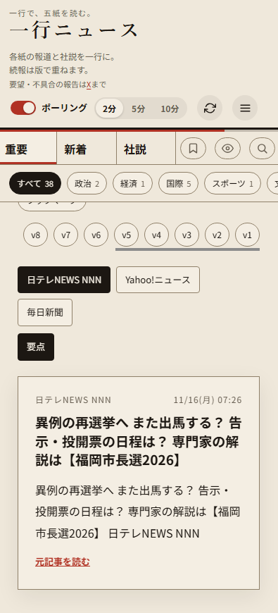
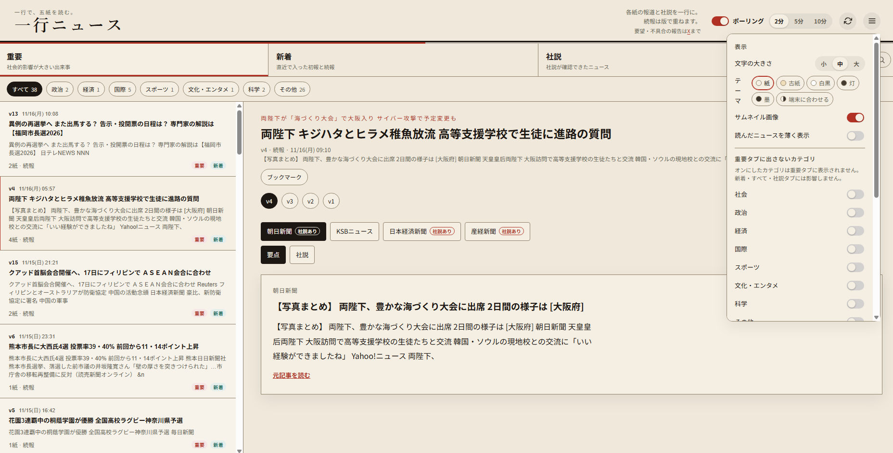

# 一行ニュース

一行で、五紙を読む。

同じ事件でも、朝日と読売では見出しが違う。社説まで読むと、各紙が何を問題だと思っているかが見えてくる。とはいえ五紙を毎日読む時間は無いし、ニュースアプリのまとめは「違い」の部分を均してしまう。

一行ニュースは、同じニュースを一行に集約し、五紙とNHK・共同・時事の報道を横に並べる個人用のリーダーです。続報は別のニュースにせず、同じニュースの版（v2、v3…）として積みます。社説が確認できた紙には社説も付けます。重要かどうかは「直近24時間で、新聞の1面・2面に載る水準か」で測ります。

取得はアプリを開いた時だけ。要約は「要点」と呼んでいる抽出で、AIではなくルールで文を選んでいます。取れなかった本文は取れなかったと表示します。その割り切りも含めての仕様です。

## なぜ作ったか

見出しの強い記事ほど広く回る。回るうちに、その紙の切り取り方まで一緒に広がって、ものの見方が寄っていく。同じニュースを一行に集めて五紙の報道と社説を並べたのは、その対策としてだ。どこまでが事実で、どこからが各紙の味付けか、そこまでを興味の対象に。

ニュースは探しに行くものではなく、目に入るものであってほしい。サブディスプレイに開きっぱなしにして、ポーリングで最新を追わせる。重要なものも、そうじゃないものも視界の端からアクセスできる。

社説は各紙の立場が一番出る読み物なのに、たどり着くまでの手間が一番かかる。記事と同じ画面で、そのまま読めるようにした。

更新情報と連絡先は X の [@ichigyo_news](https://x.com/ichigyo_news) です。要望・不具合の報告は X までお願いします。


PC では一覧と詳細を並べる。


スマホ幅では一覧と詳細を別画面に分け、スワイプで行き来する。



スマホ幅の詳細。版はチップで切り替える。



テーマは紙・古紙・白黒・灯・墨から選べる。

## 仕組み

収集元は公開RSSのみです。NHK（カテゴリ別）、朝日・読売・毎日・日経・産経・時事・共同の各紙ドメイン検索を含むGoogleニュース、Yahoo!ニュース、朝日と時事の公式RSSを組み合わせています。新聞デジタル版の購読は前提にしておらず、有料本文は扱いません（元記事へのリンク提示のみ）。

届いた記事は、見出しの単語の一致を手がかりに同じニュースへまとめます（クラスタリング）。新しい事実を含む続報が来た時だけ版が上がり、同内容の他紙報道が増えただけでは版は上がらず、その版の報道に追加されます。

詳細を開くと、そのニュースに対する各紙の報道と、取れた記事については本文が読めます。本文が取れた記事からは「要点」を抽出します。見出しの言い換えではない文、数字や固有名詞を含む文を優先して最大3文を選ぶルールベースの抽出で、原文のまま並べます。社説はニュース単位で自動確認し、見つかった紙の社説だけを表示します。見つからなかった紙は「確認できませんでした」と表示し、他の紙の社説で代用することはしません。

重要度は、直近24時間の活動（各紙が独自に報じているか、通信社配信の複製ではないか、版の積み上がり、社説で取り上げた紙があるか）だけで計算します。24時間より前の蓄積では膨らませず、窓の中に動きの無いニュースは重要タブに出ません。

## 画面の構成

タブは「重要」「新着」「社説」の3つです。重要は上記の物差しで並び、新着は版が作られた順、社説は社説が確認できたニュースだけを並べます。各タブともカテゴリ（社会／政治／経済／国際／スポーツ／文化・エンタメ／科学／その他）のチップで絞り込めます。

タブの並びとは別に、右端にブックマーク、キーワード、検索の入口があります。

- ブックマーク: 詳細から保存したニュースを、最新版だけブックマークした順に並べます。
- キーワード: 登録した語を含むニュースだけを見るビューです。キーワードは眺める条件であると同時に収集のクエリでもあり、更新のたびにキーワード検索のRSSも取りに行きます（登録は20件まで）。表記ゆれ（例: 漏洩／漏えい）は正規化して照合します。
- 検索: 自由な語でその場で検索します。照合の仕組みはキーワードと同じで、検索結果からそのままキーワード登録もできます。

詳細では版をチップで切り替えて読み比べられます。各紙の報道には記者名（バイライン）が抽出できた場合に表示され、同じ媒体・同じ記者の記事一覧も開けます。ただし署名が付く記事は限られます（後述）。

マストヘッドの「ポーリング」をONにすると、タブを開いている間だけ2分／5分／10分間隔で自動更新します。横のディスプレイに開きっぱなしにして、重要なニュースが目に入る使い方を想定しています。常時収集サーバーにはしません。

## 配布版（Windows exe）

GitHub の Releases に Windows 向けの単一 exe（`ichigyo-news-win32-x64.exe`、約90MB）を置いています。Node.js のインストールは不要で、ダブルクリックするとサーバーが起動し、既定ブラウザで http://localhost:8787 が自動で開きます。止める時は、起動時に出るコンソール画面を閉じてください。

初回起動時に「Windows によって PC が保護されました」という警告（SmartScreen）が出ることがあります。exe にコード署名が無いためで、個人開発では署名証明書の費用が見合わず、未署名のまま配っています。実行する場合は、警告画面の「詳細情報」を押すと出てくる「実行」から進んでください。配布元がこのリポジトリの Releases であることを確認してから実行してください。

データ（SQLite）は `%APPDATA%\ichigyo-news\news.db` に作ります。保存先は環境変数 `ICHIGYO_DATA_DIR` で変更できます。ブラウザを自動で開かないようにするには `ICHIGYO_NO_BROWSER=1` を指定します。`PORT` など他の環境変数も Node.js 版と同じです。アンインストールは、exe とデータフォルダを削除するだけです。

## 起動方法

Node.js から起動する場合は Node.js 22 以上が必要です。サーバー側は Node 標準ライブラリのみで作っており、依存パッケージのインストールは要りません。UIのビルド済み成果物も `public/` に入っているので、通常の起動にビルドは不要です。

```
node server.mjs
```

ブラウザで http://localhost:8787 を開いてください。データは `data/news.db`（SQLite）に貯まります。

環境変数:

- `PORT`: 待ち受けポート（既定 8787）
- `HOST`: 待ち受けアドレス（未指定時は全インターフェース）
- `ACCESS_TOKEN`: 設定すると画面・APIの全リクエストにトークン認証を要求します。初回は `http://…:8787/?token=<トークン>` で開くと cookie が発行され、以降は cookie で判定します。LANに公開する場合は設定を推奨します（未設定時は無認証です）。

スマホからは、同じネットワーク内で PC のIPアドレス:8787 を開いてください。PWA対応で、ホーム画面に追加できます。スマホでは一覧と詳細は別画面になり、横スワイプで行き来します。PCでは一覧／詳細の分割幅をドラッグで変えられます。

## 設定

設定と保守はマストヘッド右端のハンバーガーメニューに集約しています。

- 文字の大きさ: 小／中／大
- テーマ: 紙（明るい紙色）／古紙（セピア系の明るい色）／白黒（純白と真っ黒）／灯（墨より一段明るい暗色）／墨（柔らかい暗茶）／端末に合わせる、のプリセットから選ぶ。各プリセットが背景・文字・差し色のパレット全体を決めます
- 既読を薄く表示: 開いたニュースの行を薄くする（既定ON）
- カテゴリのミュート: 指定したカテゴリを重要タブに出さない（他タブには影響しません）
- サムネイル表示: 一覧の画像のON／OFF
- キーワードの管理: ウォッチ用キーワードの登録・削除
- データを整理: 7日より前のニュース（ブックマークを除く）を削除し、データベースを圧縮します。DB容量もここに表示されます。

データの保持は、ニュース一律で最終確認から7日です。収集のたびに期限切れを関連データごと削除します。ブックマークしたニュースは削除から免除されます。

## 正直なところ（制限）

- 本文が取れる記事は多くありません。取得元の大半がGoogleニュースのラッパーURLで、実URLの解決はGoogleの非公式な内部方式に依存しており、環境によっては全く解決できません。実測では本文まで取れたのは対象記事の2割強でした。取れない記事は「要点」ではなくRSS抜粋ベースの表示になります。
- クラスタリングは単語の一致ベースのヒューリスティクスです。言い換えの大きい続報を別ニュースに分けてしまうこと、逆に無関係な記事を寄せてしまうことがあります。そもそも1回しか現れない記事が多いため、単独のニュースの比率は高め（約8割）です。
- 社説の照合も特徴語の共有による判定で、無関係な社説が混ざる可能性は残ります。見つからない場合は捏造せず「確認できませんでした」と出します。
- 開いた時だけ取得するので、閉じている間の報道は取りこぼします。v1は「このアプリが初めて検出した版」であって、厳密な意味での最初の報道とは限りません。
- 記者名は、本文やメタ情報に署名がある記事からしか取れません。配信記事やNHKには基本的に無く、有料紙も無料公開部分に署名が含まれないことが多いため、付く記事は限られます。実データではほぼ付きませんでした。記者の傾向を自動で判定・表示することはしません。
- 重要度は単純な式で編集判断の代替にはなりません。「1面・2面の物差し」は目安です。

## セキュリティ

- 静的配信は `public/` 配下のみを返し、セキュリティヘッダ（`X-Content-Type-Options: nosniff`、`Referrer-Policy: no-referrer`、`X-Frame-Options: DENY`、`Content-Security-Policy: frame-ancestors 'none'`）を付けます。
- 本文取得はSSRF対策として http/https のみ許可し、localhost・プライベートIP等への取得は行いません。リダイレクトは各ホップで同じ検査をします。
- SQLはすべて prepared statement で、カテゴリ等はホワイトリスト照合してから使います。
- サムネイル画像は各媒体の og:image 等のURLを参照表示するだけで、画像データ自体は保存しません。

## 権利・規約に関する注意

- 取得対象は公開RSSと各媒体の公開ページのみです。各媒体の利用規約・robots の定めを尊重してください。
- 本文抽出は私的利用の範囲を前提としています。抽出した本文の再配布を目的とするものではありません。
- Googleニュース等のRSSは非公式な公開フィードであり、仕様変更や提供終了があり得ます。

## 開発

- テスト: `npm test`（Node標準の test runner、ネットワーク不要）
- UIの変更: `frontend/`（Vite + React + TypeScript）が正です。変更したら `cd frontend && npm install && npm run build` で `public/` へ再ビルドしてください。
- ブランチ運用とコントリビューションのルール: [CONTRIBUTING.md](CONTRIBUTING.md)
- バージョニングとリリースの手順: [RELEASING.md](RELEASING.md)
- 要件と決定の記録: [REQUIREMENTS.md](REQUIREMENTS.md)

## 連絡先

要望・不具合の報告は X の [@ichigyo_news](https://x.com/ichigyo_news) まで。GitHub の Issue はバグ報告と機能要望の窓口として開けていますが、使い方の相談は X の方が早く拾えます。

寄付で応援したい方は [Ko-fi](https://ko-fi.com/ichigyo_news) から。いただいた分は開発時間と検証環境の足しにします。

ライセンスは MIT です（[LICENSE](LICENSE)）。
